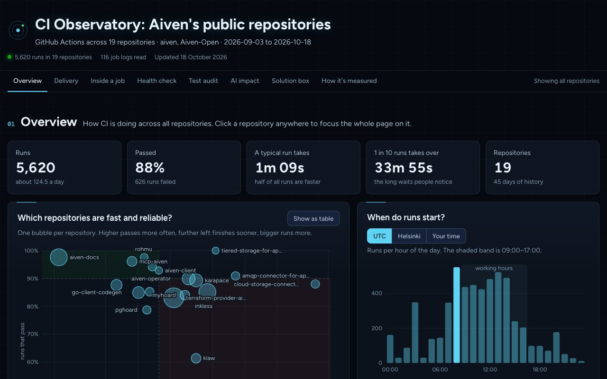

# CI Observatory

[](https://github.com/kirbac1/ci-observatory/actions/workflows/ci.yml)
[](https://kirbac1.github.io/ci-observatory/)
[](LICENSE)

**See how your CI/CD really works.** One command reads the GitHub Actions history of your repositories, public or
private, and writes a single HTML report: what is slow, what fails and why, which tests run twice, how fast you ship,
how much AI is involved, and what to fix first.

**[Live demo](https://kirbac1.github.io/ci-observatory/demo/)** · [Website](https://kirbac1.github.io/ci-observatory/) ·
[Documentation](#documentation)

```sh
curl -LsSf https://kirbac1.github.io/ci-observatory/install.sh | sh
ci-observatory --org your-org --open
```

[](https://kirbac1.github.io/ci-observatory/demo/)

The demo is built from public data of 19 repositories in the `aiven` and `Aiven-Open` GitHub organisations, from
3 September to 18 October 2026. It is not affiliated with or endorsed by Aiven.

## What you get

One self-contained `index.html` with seven sections. Every chart answers one question in plain words, and clicking a
repository anywhere focuses the whole page on it.

| Section | The question it answers |
| --- | --- |
| **Overview** | Which repositories are fast and reliable? When do runs start? How many pass each day? |
| **Delivery (DORA)** | How often do you ship, how long from pull request to release, how often does a release need a fix, and how fast is a broken main branch fixed? Each rated Low to Elite. |
| **Inside a job** | For any job: where did the time go, which steps ran, what did the log say, and if it failed, why? |
| **Health check** | Why do jobs fail? Where does job time go? Are the safety basics (read-only tokens, pinned actions, time limits) in place? |
| **Test audit** | On one recent pull request per repository, which tests ran more than once, and was the repeat useful or waste? |
| **AI impact** | Which AI tools and models write and review code, how much CI time involves AI, and do AI-written changes run into more problems? |
| **Solution box** | Every problem found, with the gain and how to fix it (often ready YAML), in the order to tackle them. |

What each chart means, and what to do about it, is in [Reading the report](docs/report-guide.md).

## Install

You need the [GitHub CLI](https://cli.github.com), logged in (`gh auth login`). Everything else comes with the
installer.

**macOS and Linux, one line:**

```sh
curl -LsSf https://kirbac1.github.io/ci-observatory/install.sh | sh
```

It installs [uv](https://docs.astral.sh/uv/) if you don't have it (uv brings its own Python, so your system Python is
never touched), then installs the `ci-observatory` command with `uv tool install`. No sudo. The script is
[short and readable](install.sh); read it first if you like.

**Run once without installing anything** (anywhere uv runs):

```sh
uvx --from git+https://github.com/kirbac1/ci-observatory ci-observatory --org your-org --open
```

**With pipx**, if that's what you use:

```sh
pipx install git+https://github.com/kirbac1/ci-observatory
```

Pinning a version, upgrading, uninstalling and installing behind a proxy are in [docs/install.md](docs/install.md).

## Quick start

```sh
gh auth login                          # once
ci-observatory --org your-org --open   # the 12 busiest repositories of an organisation
```

It prints its progress, takes about 5 to 10 minutes for a dozen repositories, and opens
`./ci-observatory/index.html` in your browser. A second run reuses the cached job logs and is much faster.

Inside a clone of any GitHub repository, no arguments are needed:

```sh
cd ~/code/my-service
ci-observatory --open
```

## Everyday commands

| You want | Command |
| --- | --- |
| The repository you are in | `ci-observatory --open` |
| One or a few repositories | `ci-observatory --repo my-org/api --repo my-org/web` |
| The 12 busiest repositories of an organisation | `ci-observatory --org my-org` |
| The 25 busiest, private ones only | `ci-observatory --org my-org --top 25 --visibility private` |
| Several organisations in one report | `ci-observatory --org my-org --org my-other-org` |
| Your own account, private repositories included | `ci-observatory --org my-login` |
| A fast first look | `ci-observatory --org my-org --quick` |
| The last 60 days | `ci-observatory --org my-org --days 60` |
| Skip job logs, the test audit, or AI and DORA | `--no-logs`, `--no-tests`, `--no-ai` |
| Another output folder or title | `--out reports/2026-10 --title "Payments CI"` |

<details>
<summary>All options</summary>

```text
ci-observatory [--org ORG]... [--repo OWNER/NAME]... [options]

  --org ORG             organisation or user to scan (repeatable)
  --repo OWNER/NAME     repository to scan (repeatable)
  --top TOP             with --org: how many of the busiest repositories (default 12)
  --min-runs MIN_RUNS   with --org: skip repositories with fewer runs (default 10)
  --visibility {all,public,private}
                        with --org: which repositories (default all)
  --days DAYS           look back this many days (default 30)
  --out OUT             output folder (default ./ci-observatory)
  --title TITLE         report heading (default: CI Observatory)
  --quick               smaller samples: fewer API calls and log downloads
  --no-logs             skip job logs and the test audit
  --no-tests            skip the test redundancy audit
  --no-ai               skip AI and DORA signals
  --max-calls MAX_CALLS API call budget per step (default 4000)
  --open                open the report in your browser when it is ready
  --version             show the version and exit
```

Exit codes: `0` done; `1` done, but a limit was reached or some data was missing (the report says what); `2` bad
usage, or `gh` is missing or not logged in.

</details>

## Private repositories

The command does not change. What matters is that your `gh` login, or the token you hand to `gh`, can read the
repositories. Three ways:

1. **Your own gh login (simplest).** Add the scopes once, then run as usual:

   ```sh
   gh auth refresh -h github.com -s repo,read:org
   ci-observatory --org my-org --visibility private --open
   ```

   If your organisation uses SAML single sign-on, also authorise the GitHub CLI for it at
   <https://github.com/settings/applications>. Without that, private repositories look like "Not Found".

2. **A fine-grained token (least privilege).** Give it read-only **Actions**, **Contents** and **Pull requests** on the
   repositories you choose, then:

   ```sh
   GH_TOKEN=github_pat_... ci-observatory --org my-org
   ```

3. **Inside GitHub Actions.** The workflow's own token can read its repository; a GitHub App token can read a whole
   organisation. See [docs/github-actions.md](docs/github-actions.md).

Before collecting anything, the tool checks that it can read every `--repo` and tells you which are private. The
step-by-step guide, with SSO, token approval, GitHub Enterprise Server and troubleshooting, is
[docs/private-repositories.md](docs/private-repositories.md).

## Safe by design

- **Read-only.** Every request is `gh api --method GET`. Nothing is written to GitHub.
- **It never sees your token.** The GitHub CLI holds the credentials; this tool only runs `gh`.
- **Everything stays on your machine.** One HTML file and its data, in a folder you choose. No server, no telemetry.
  Raw logs are cached in `~/.cache/ci-observatory/` and can be deleted at any time.
- **People are not named.** Authors and reviewers are counted as "people"; only bots and AI accounts appear by name.
  Log excerpts are cleaned of names, emails, tokens and IP addresses.
- **No dependencies.** Python's standard library and `gh`. The report uses plain SVG and no JavaScript libraries.

The report still describes your repositories (their names, workflow names, cleaned log lines, and the titles of
AI-assisted pull requests), so share it the way you would share the repositories themselves.

## What it reads, and what it costs

| Step | Reads | Typical API calls |
| --- | --- | --- |
| 1. actions | workflows, runs (newest 1,000 per repository), sampled jobs and steps, workflow files, pull requests, releases | 30–60 per repository |
| 2. logs | the latest failed and successful jobs per repository, then every job of one recent pull request commit | 15–45 per repository |
| 3. signals | agent instruction files, AI workflows and their runs, pull requests with commits and reviews, default-branch commits, releases | 20–80 per repository |
| 4. report | nothing; it builds `index.html` from the data | 0 |

A dozen repositories take 1,000 to 2,000 calls, well within GitHub's 5,000 an hour. `--quick` roughly halves that.
Each step stops cleanly at `--max-calls` or on a rate limit, and the report says what is missing.

## Documentation

| Guide | What's in it |
| --- | --- |
| [Install](docs/install.md) | Every way to install, run once, pin a version, upgrade and uninstall |
| [Private repositories](docs/private-repositories.md) | gh scopes, SAML SSO, fine-grained tokens, GitHub Enterprise Server, troubleshooting |
| [GitHub Actions](docs/github-actions.md) | A weekly report for one repository, or for a whole organisation with a GitHub App |
| [Reading the report](docs/report-guide.md) | Every section and chart, what it means, and what to do about it |
| [How it works](docs/how-it-works.md) | The pipeline, the data files, how every number is made, DORA proxies, AI detection, limits |

## Developing

```sh
git clone https://github.com/kirbac1/ci-observatory && cd ci-observatory
uv run pytest                                  # unit tests
uv run ruff check && uv run ruff format --check
uv run mypy                                    # strict
sh scripts/build-site.sh && python3 -m http.server -d _site   # the website and demo, at http://localhost:8000
```

The code is in `src/ci_observatory/`: one module per step (`actions.py`, `logs.py`, `signals.py`, `report.py`), a
small `gh` wrapper (`gh.py`) and the command (`cli.py`). The page is in `src/ci_observatory/web/`: `page.html`,
`observatory.css` and the `obs-*.js` modules. To work on the page without calling GitHub, rebuild the demo from the
saved data:

```sh
uv run python -m ci_observatory.report --data-dir demo/data --out /tmp/report.html && open /tmp/report.html
```

Every push runs tests on Python 3.11 and 3.14, ruff, mypy, a syntax check of the page scripts, and a build of the site.
Pushes to `main` publish the website and the demo to GitHub Pages.

## License

[MIT](LICENSE)
