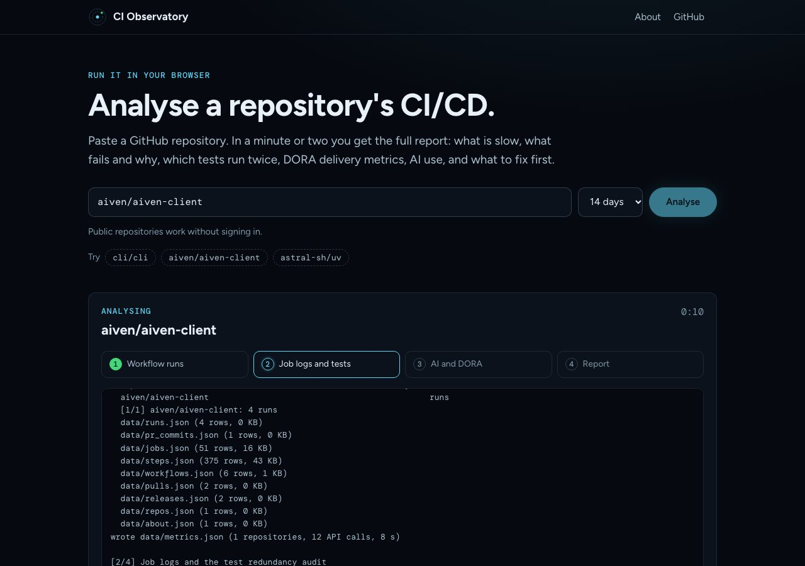

# The web app

The web app runs the same analysis on a server, so people can use CI Observatory without installing anything. They
paste a repository, watch the analysis run, and get the report in the browser. Public repositories work without
signing in. Signing in with GitHub lets people analyse private repositories they can read.

An owner works too: type `aiven` (or paste `github.com/aiven`) and the report covers that user's or organisation's
public repositories together: those pushed to in the window with at least 3 CI runs, the busiest 15 (25 when signed
in). An owner's report always covers public repositories only, even for people who are signed in, so it can be shared
and reused like any public report. It may take twice as long as one repository before the server stops it.



- [How it works](#how-it-works)
- [Security model](#security-model)
- [Run it locally](#run-it-locally)
- [Configuration](#configuration)
- [Register the GitHub App](#register-the-github-app)
- [A token for public repositories](#a-token-for-public-repositories)
- [Deploy to Google Cloud Run](#deploy-to-google-cloud-run)
- [Deploy anywhere else](#deploy-anywhere-else)
- [Limits and costs](#limits-and-costs)
- [Troubleshooting](#troubleshooting)

## How it works

```
browser ──► GET /                      the page: a repository box, sign-in, recent reports
        ──► POST /api/analyses         check the repository with GitHub, then queue the analysis
        ◄── GET /api/analyses/{id}/events   live progress (server-sent events)
        ──► GET /r/{id}                the finished report

server  ──► ci-observatory --repo OWNER/NAME --days N --out <job folder>   one subprocess per analysis
              └── GitHub REST API, GET only, with the visitor's token or the server's public-data token
```

- **One analysis is one run of the command line tool**, in a subprocess with its own folder and cache. The
  subprocess gets the token it needs and nothing else from the server's environment, so it never sees the app's
  client secret or other secrets.
- **Not signed in:** the server reads public repositories with its own token (`CIO_SERVER_TOKEN`) and smaller
  samples (`--quick`), so one shared quota goes further.
- **Signed in:** the analysis uses the visitor's own token and quota, with full samples, and can read private
  repositories the visitor can read and the app is installed on.
- **Public reports are shared and reused.** Ask for a repository someone analysed in the last few hours and the
  report opens at once. Private reports are never shared or listed.

## Security model

| Concern | What the app does |
| --- | --- |
| The visitor's GitHub token | Stays on the server, in memory, for at most 8 hours. The browser holds only a random session ID in an `HttpOnly`, `SameSite=Lax` cookie (`Secure` over HTTPS). Signing out revokes the token with GitHub. |
| What the token can do | A GitHub App asks only for read-only Actions, Contents and Pull requests. Unlike an OAuth App's `repo` scope, it cannot write anything. |
| Signing in | The OAuth state is random, bound to the browser by a short-lived cookie and checked on return, and the flow uses PKCE. Every sign-in gets a new session ID. The return address must be a path on this site. |
| Private repositories for people who are not signed in | Never. A private repository answers "not found" to them, even when the server's own token could read it. |
| Private reports | Visible only to the session that asked for them (`Cache-Control: no-store`), never listed, and deleted when that person signs out or after `CIO_PRIVATE_KEEP_MINUTES` (60 by default). A restart deletes them all. |
| Cross-site requests | Starting, cancelling and signing out must come from the app's own origin. The page has a strict Content Security Policy (no inline scripts) and cannot be framed. |
| Logs | Request logs carry the method, path and status only, never query strings, so sign-in codes are not logged. |
| Abuse | Rate limits per visitor and overall for anonymous analyses; per person when signed in; a cap on running and waiting analyses; a time limit per analysis; anonymous analyses stop when the server token's quota runs low. |

## Run it locally

```sh
git clone https://github.com/kirbac1/ci-observatory && cd ci-observatory
CIO_SERVER_TOKEN=$(gh auth token) uv run --extra server python -m ci_observatory.server
```

Open <http://localhost:8000>. That runs without sign-in; public repositories only. To try signing in locally, register
a GitHub App (below) with the callback URL `http://localhost:8000/auth/callback` and set `CIO_CLIENT_ID` and
`CIO_CLIENT_SECRET` as well.

`gh auth token` is your own token. It is fine on your machine, but don't deploy it: use a public-data-only token
([below](#a-token-for-public-repositories)).

With Docker:

```sh
docker build -t ci-observatory .
docker run --rm -p 8080:8080 -e CIO_PUBLIC_URL=http://localhost:8080 -e CIO_SERVER_TOKEN=github_pat_... ci-observatory
```

## Configuration

Everything is an environment variable.

| Variable | Default | What it does |
| --- | --- | --- |
| `CIO_PUBLIC_URL` | `http://localhost:8000` | The address people use. Builds the sign-in callback (`<url>/auth/callback`) and is the only origin allowed to start analyses. |
| `CIO_CLIENT_ID`, `CIO_CLIENT_SECRET` | | The GitHub App's client ID and a client secret. Without them, signing in is off. |
| `CIO_APP_SLUG` | | The app's URL name (`github.com/apps/<slug>`), for the "install the app" links. |
| `CIO_SERVER_TOKEN` | | Reads public repositories for people who are not signed in. Without it, everyone must sign in. |
| `CIO_OAUTH_SCOPE` | | Only for a classic OAuth App instead of a GitHub App, for example `repo`. Leave it empty for a GitHub App. |
| `CIO_DATA_DIR` | a temporary folder | Where analyses and reports are written. `/data` in the container. |
| `CIO_MAX_JOBS` | `2` | Analyses running at once. |
| `CIO_QUEUE_LIMIT` | `20` | Analyses waiting before new ones are refused. |
| `CIO_JOB_TIMEOUT` | `900` | Seconds before an analysis is stopped. |
| `CIO_PUBLIC_CACHE_HOURS` | `6` | How long a public report is kept and reused. |
| `CIO_PRIVATE_KEEP_MINUTES` | `60` | How long a private report is kept. |
| `CIO_ANON_PER_HOUR` | `6` | Analyses one visitor who is not signed in can start per hour. |
| `CIO_ANON_TOTAL_PER_HOUR` | `60` | All analyses by people who are not signed in, per hour. |
| `CIO_USER_PER_HOUR` | `20` | Analyses one signed-in person can start per hour. |
| `CIO_MIN_SERVER_QUOTA` | `600` | Below this many API calls left on the server token, only signed-in people can start analyses. |
| `HOST`, `PORT` | `127.0.0.1`, `8000` | Where the server listens. The container uses `0.0.0.0` and `8080`. |

## Register the GitHub App

Do this once, on the account or organisation that will own the app.

**The quick way** is the setup script. It opens a page on your machine that creates the app through GitHub's
manifest flow (you confirm once on github.com), then asks for the public-data token, checks that it cannot read any
private repository, and stores both. With `--cloud-run`, they go straight into Secret Manager and onto the service;
without it, into `./ci-observatory.env`:

```sh
python3 scripts/setup-github-app.py --public-url https://YOUR-SERVICE-URL \
  --cloud-run ci-observatory --region europe-north1 --project MY_PROJECT
```

**By hand** it takes about five minutes:

1. Open **Settings → Developer settings → GitHub Apps → New GitHub App**
   (<https://github.com/settings/apps/new>, or the same page under an organisation's settings).
2. Fill in:
   - **GitHub App name:** for example *CI Observatory* (it must be unique on GitHub).
   - **Homepage URL:** the app's address, or this repository.
   - **Callback URL:** `<CIO_PUBLIC_URL>/auth/callback`, for example `https://ci-observatory-123456789.europe-north1.run.app/auth/callback`. Add a second one for local testing if you like: `http://localhost:8000/auth/callback`.
   - **Expire user authorization tokens:** leave it ticked. Tokens then last 8 hours.
   - **Request user authorization (OAuth) during installation:** leave it unticked. People sign in through the app,
     which checks its own sign-in state; an installation that signs people in directly would skip that check and be
     refused.
   - **Setup URL:** `<CIO_PUBLIC_URL>/`, with **Redirect on update** ticked, so people come back to the app after
     installing it.
   - **Webhook:** untick **Active**. The app needs no events.
3. **Permissions → Repository permissions:** set **Actions**, **Contents** and **Pull requests** to **Read-only**.
   **Metadata** becomes read-only by itself. Leave everything else at *No access*, including all organisation and
   account permissions.
4. **Where can this GitHub App be installed?** *Any account*, so other people can install it on their own
   organisations to analyse their private repositories. Choose *Only on this account* to keep it to yourself.
5. Click **Create GitHub App**.
6. On the app's page, note the **Client ID**, then under **Client secrets** click **Generate a new client secret** and
   copy it. You don't need a private key: the app never acts as itself, only on behalf of a signed-in person.
7. Note the app's URL name from its public page, `https://github.com/apps/<slug>`.

Then set `CIO_CLIENT_ID`, `CIO_CLIENT_SECRET` and `CIO_APP_SLUG`.

**How people get private repositories in.** A GitHub App's user token reaches only repositories where the app is
installed. People install it from `https://github.com/apps/<slug>/installations/new`, choose their account or
organisation and the repositories, and sign in. The app links to that page whenever a signed-in person asks for a
repository it cannot see. On an organisation, an owner may have to approve the installation.

## A token for public repositories

People who are not signed in are served with `CIO_SERVER_TOKEN`. Make it a token that can read public data and
nothing else, so a mistake can never expose a private repository:

1. **Settings → Developer settings → Personal access tokens → Fine-grained tokens → Generate new token.**
2. **Resource owner:** your own account. **Repository access:** *Public repositories*. No permissions are needed for
   public data.
3. Set an expiry date, generate it, and store it as a secret.

It gets 5,000 API calls an hour. A quick analysis of one repository uses about 30 to 150; an owner's uses more,
one listing call per active repository plus the analysis of each one it keeps.

## Deploy to Google Cloud Run

Cloud Run builds the container from this repository and runs it on demand. The app keeps sessions and running
analyses in memory, so it runs as **one instance**; with `--no-cpu-throttling`, analyses keep running between
requests.

1. Pick a project and region, and enable the services once:

   ```sh
   gcloud config set project MY_PROJECT
   gcloud services enable run.googleapis.com cloudbuild.googleapis.com artifactregistry.googleapis.com secretmanager.googleapis.com
   ```

2. Store the secrets:

   ```sh
   printf %s 'github_pat_...' | gcloud secrets create cio-server-token --data-file=-
   printf %s 'the client secret' | gcloud secrets create cio-client-secret --data-file=-
   ```

   Give the service's identity read access to them (the default compute service account, unless you use your own):

   ```sh
   SA=$(gcloud projects describe MY_PROJECT --format='value(projectNumber)')-compute@developer.gserviceaccount.com
   for s in cio-server-token cio-client-secret; do
     gcloud secrets add-iam-policy-binding $s --member=serviceAccount:$SA --role=roles/secretmanager.secretAccessor
   done
   ```

3. Deploy from the repository root:

   ```sh
   gcloud run deploy ci-observatory --source . --region europe-north1 --allow-unauthenticated \
     --max-instances 1 --concurrency 80 --cpu 1 --memory 1Gi --timeout 3600 --no-cpu-throttling \
     --set-env-vars CIO_PUBLIC_URL=https://PUBLIC-URL,CIO_CLIENT_ID=Iv23...,CIO_APP_SLUG=your-app-slug \
     --set-secrets CIO_SERVER_TOKEN=cio-server-token:latest,CIO_CLIENT_SECRET=cio-client-secret:latest
   ```

   On the very first deploy you don't know the URL yet: deploy once, read it with
   `gcloud run services describe ci-observatory --region europe-north1 --format='value(status.url)'`, set it as
   `CIO_PUBLIC_URL` (`gcloud run services update ci-observatory --region europe-north1 --update-env-vars CIO_PUBLIC_URL=...`)
   and put `<url>/auth/callback` in the GitHub App's callback URLs.

4. Check it: `curl <url>/health` answers `{"ok": true, ...}`, and the page opens at `<url>`. (Cloud Run keeps
   `/healthz` for itself, so use `/health` there.)

To use your own domain, map it to the service (Cloud Run domain mappings, or a load balancer), then change
`CIO_PUBLIC_URL` and the app's callback URL to match.

## Deploy anywhere else

Any host that runs a container works: Fly.io, Render, a VM with Docker. Run one instance of the image with the
variables above, put HTTPS in front of it (the session cookie is marked `Secure` when `CIO_PUBLIC_URL` is `https://`),
and give `/data` some temporary disk. Behind a proxy, keep response buffering off for `/api/analyses/*/events` so
progress streams; the app sends `X-Accel-Buffering: no` for nginx.

## Limits and costs

- **One instance.** Sessions, the queue and the list of reports live in memory. A restart signs everyone out and
  deletes private reports. Public reports younger than `CIO_PUBLIC_CACHE_HOURS` survive a restart where the disk
  does; on Cloud Run the disk goes with the instance, so they are analysed again when next asked for.
- **Time.** From under a minute for a quiet repository to about three minutes for a busy one (measured: 27 s for a
  small private site, 70 s for `aiven/aiven-client`, 196 s for `psf/requests` in a container).
- **GitHub quota.** Anonymous analyses share the server token's 5,000 calls an hour. Signed-in analyses use the
  person's own quota.
- **Cloud Run cost.** With CPU always allocated, you pay while the instance is up; it scales to zero after a while
  without requests. One vCPU and 1 GiB is enough for two analyses at a time.

## Troubleshooting

| What you see | Fix |
| --- | --- |
| "Signing in is not set up on this server" | Set `CIO_CLIENT_ID` and `CIO_CLIENT_SECRET`. |
| GitHub says "The redirect_uri is not associated with this application" | The app's callback URL must be exactly `<CIO_PUBLIC_URL>/auth/callback`. |
| Back from GitHub with "That sign-in link expired" | The sign-in took over ten minutes, cookies are blocked, or the address changed between http and https. Try again from the same address. |
| A private repository is "not found" after signing in | Install the app on the repository's owner and give it that repository. On an organisation with SAML SSO, authorise your session for it. |
| Every request to start an analysis gets 403 | `CIO_PUBLIC_URL` does not match the address in the browser, so the origin check fails. |
| Progress does not appear until the end | A proxy is buffering the event stream. Turn buffering off for `/api/analyses/*/events`. |
